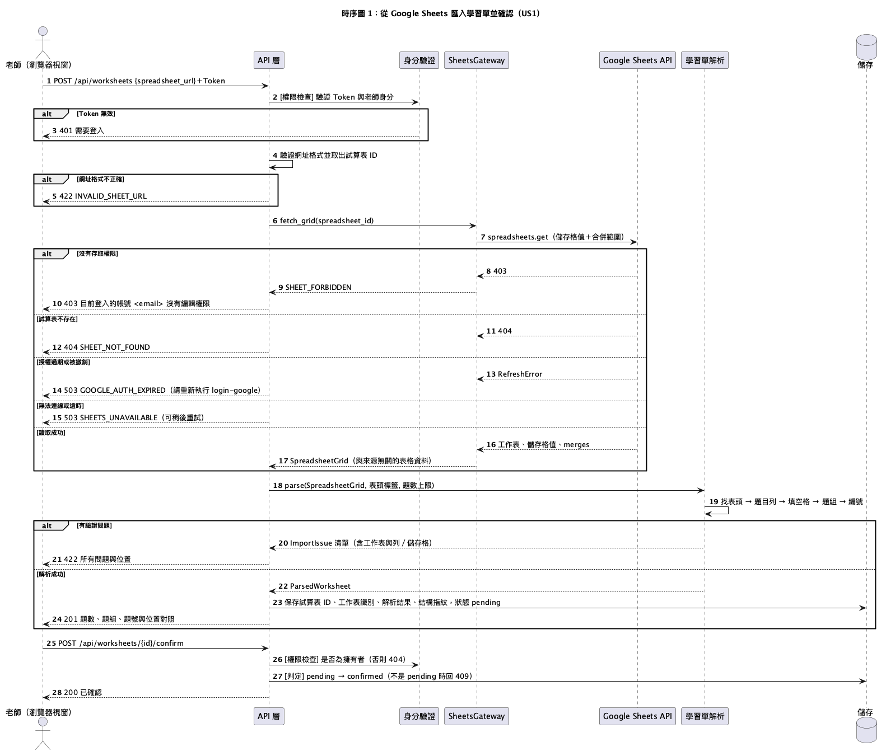
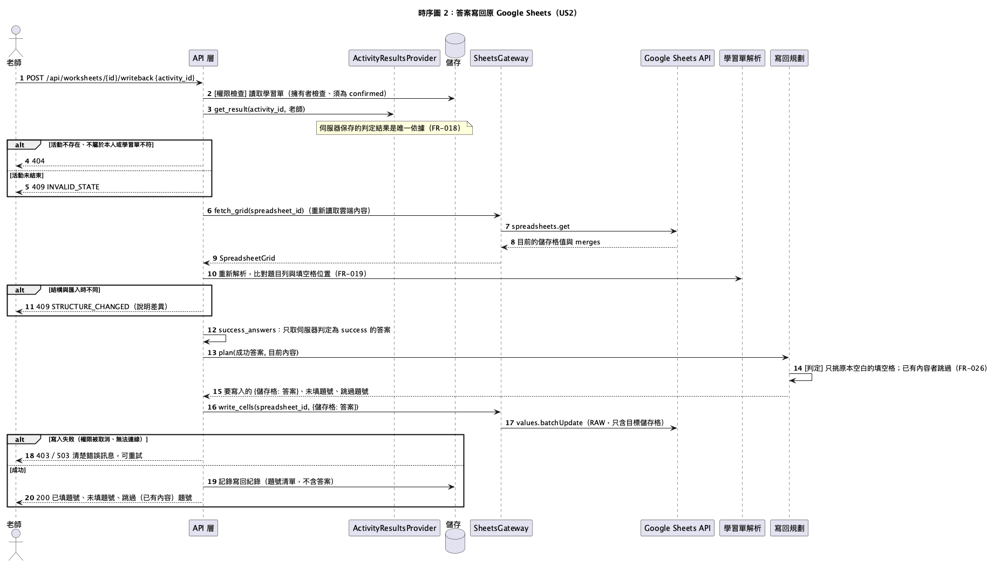
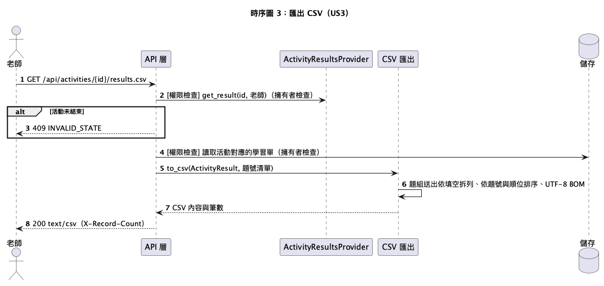
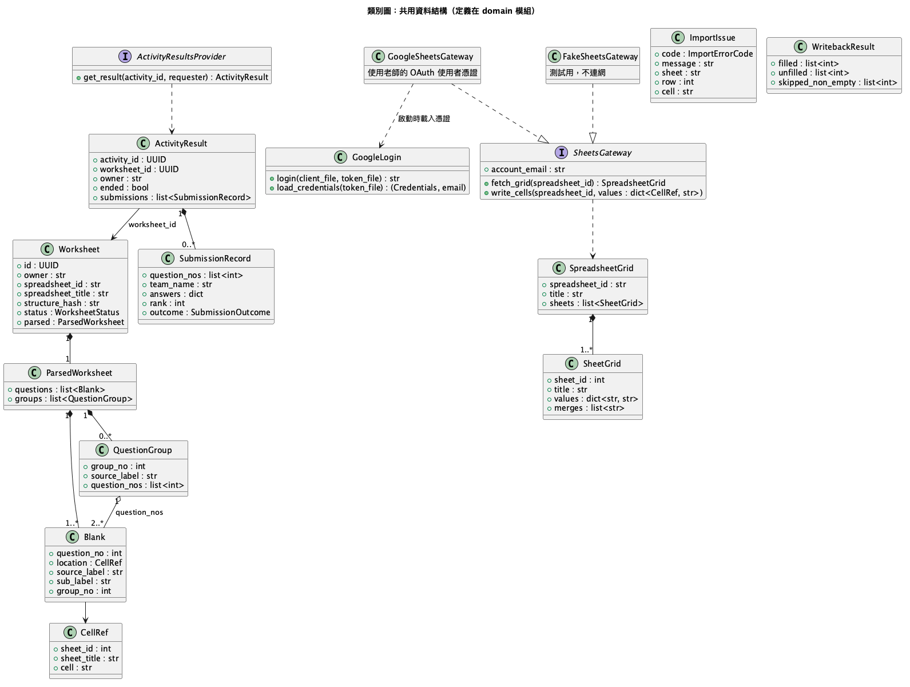
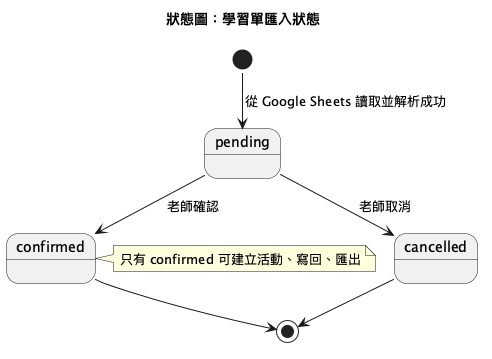
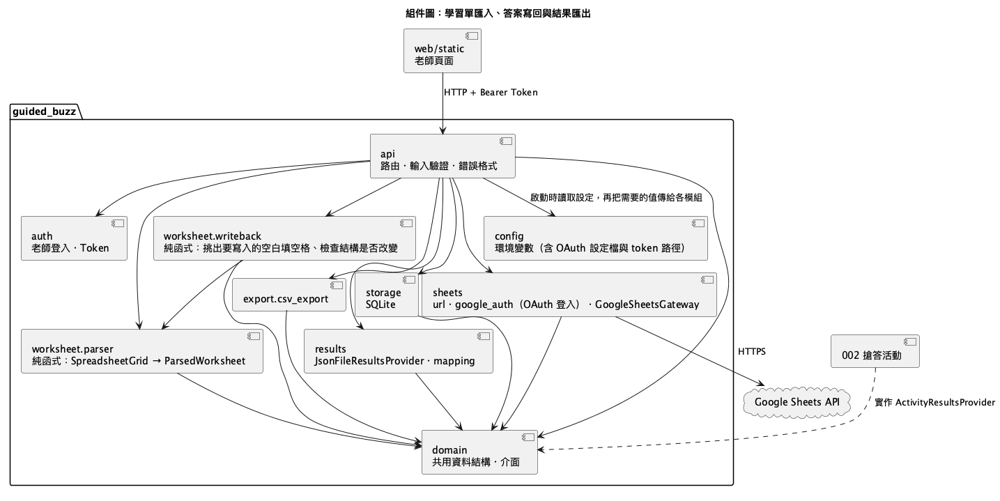
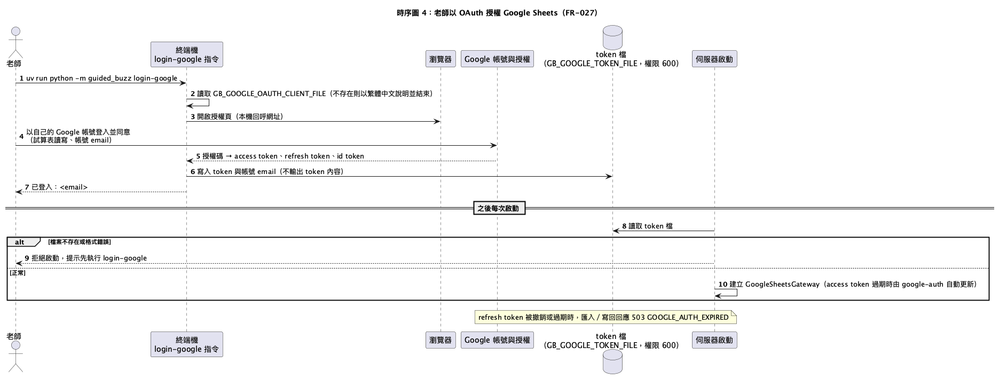

# Diagrams: 學習單匯入、答案寫回與結果匯出

> 已審閱：2026-11-22（AI 依 spec、data-model、contracts 比對，PNG 已產生；組員人工審閱後請在此補記）

**Feature**: [spec.md](./spec.md) | **Data model**: [data-model.md](./data-model.md) | **API**: [contracts/http-api.md](./contracts/http-api.md)

依 Constitution 原則 VII，圖表以 PlantUML 撰寫，原始檔與 PNG 存放在
[`diagrams/001-guided-notes-import/`](../../diagrams/001-guided-notes-import/)，須在實作前審閱。
設計變更時先改圖，再改程式。圖中「[權限檢查]」標示伺服器的權限檢查點，「[判定]」標示伺服器的判定點。

產生 PNG（在 repo 根目錄執行）：

```bash
java -jar plantuml.jar -tpng "./diagrams/**/*.puml"
```

| # | 圖表 | 原始檔 | 對應需求 |
|---|------|--------|----------|
| 1 | 時序圖：從 Google Sheets 匯入學習單並確認 | [01-sequence-import.puml](../../diagrams/001-guided-notes-import/01-sequence-import.puml) | US1、FR-001、FR-013、FR-025 |
| 2 | 時序圖：答案寫回原 Google Sheets | [02-sequence-writeback.puml](../../diagrams/001-guided-notes-import/02-sequence-writeback.puml) | US2、FR-016、FR-019、FR-026 |
| 3 | 時序圖：匯出 CSV | [03-sequence-export-csv.puml](../../diagrams/001-guided-notes-import/03-sequence-export-csv.puml) | US3 |
| 4 | 類別圖：共用資料結構 | [04-class.puml](../../diagrams/001-guided-notes-import/04-class.puml) | 共用資料結構 |
| 5 | 狀態圖：學習單匯入狀態 | [05-state-worksheet.puml](../../diagrams/001-guided-notes-import/05-state-worksheet.puml) | US1 |
| 6 | 組件圖：模組相依 | [06-component.puml](../../diagrams/001-guided-notes-import/06-component.puml) | 架構 |
| 7 | 時序圖：老師以 OAuth 授權 Google Sheets | [07-sequence-google-login.puml](../../diagrams/001-guided-notes-import/07-sequence-google-login.puml) | FR-025、FR-027 |

## 預覽









## 設計規則

- `domain` 不依賴任何其他模組。
- `parser`、`writeback`、`export` 為不做 I/O 的純函式模組（輸入表格資料或物件，輸出結果），可以獨立做單元測試。
- 所有 Google Sheets 讀寫都經過 `SheetsGateway` 介面：正式環境用 `GoogleSheetsGateway`，
  測試用 `FakeSheetsGateway`，自動化測試不連線真實 Google 服務（Constitution「專案範圍與限制」）。
