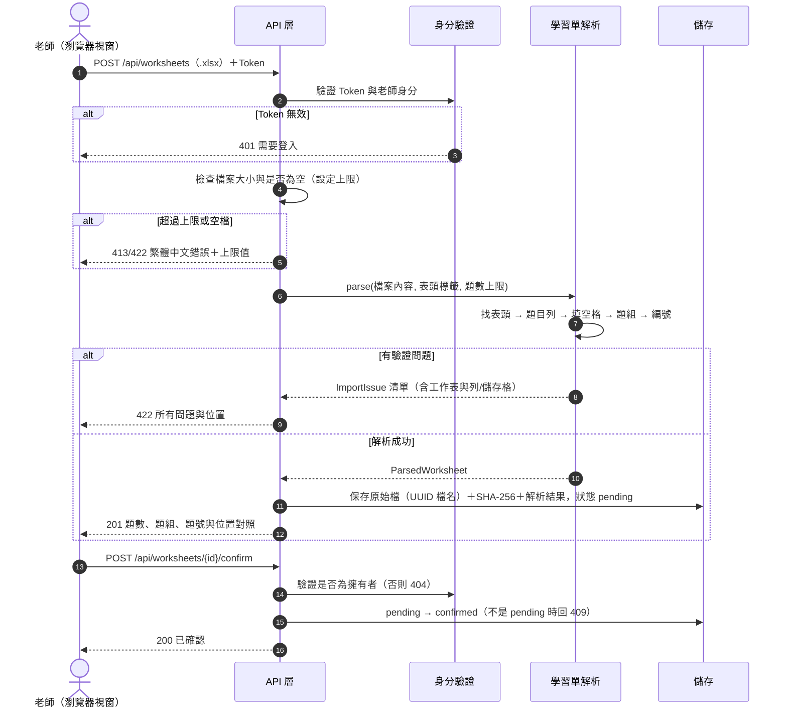
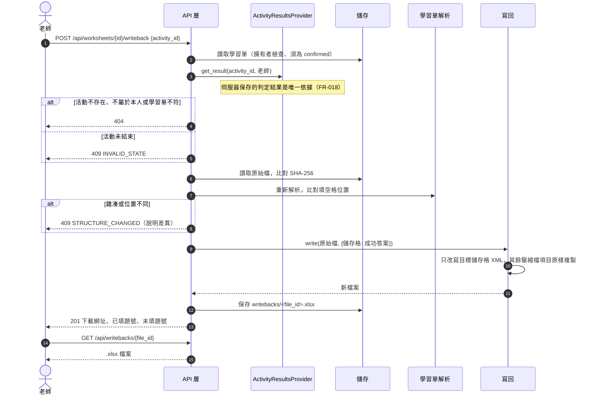
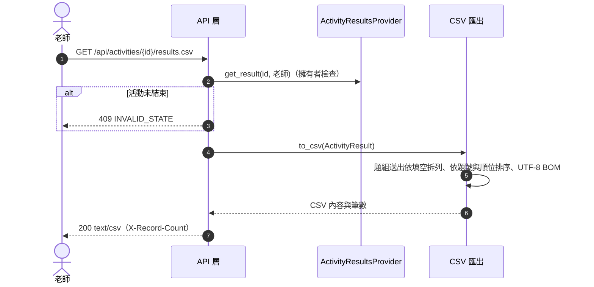
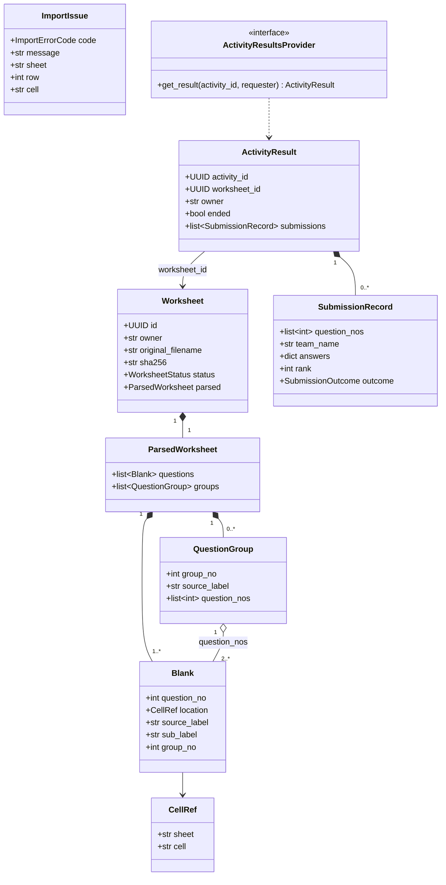
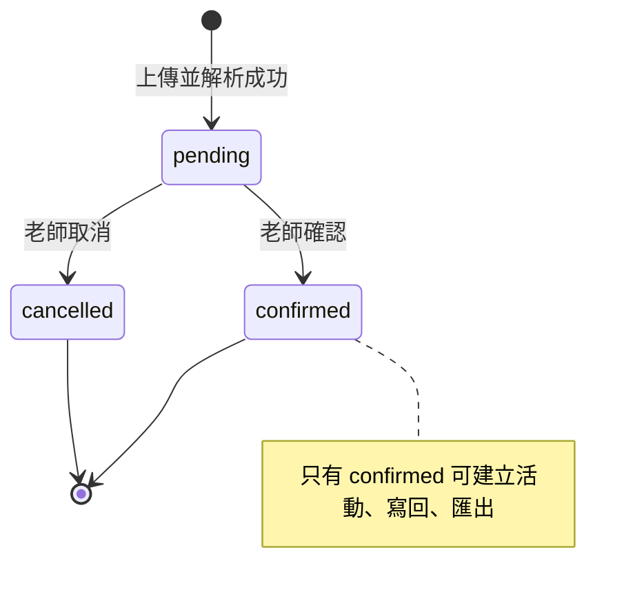
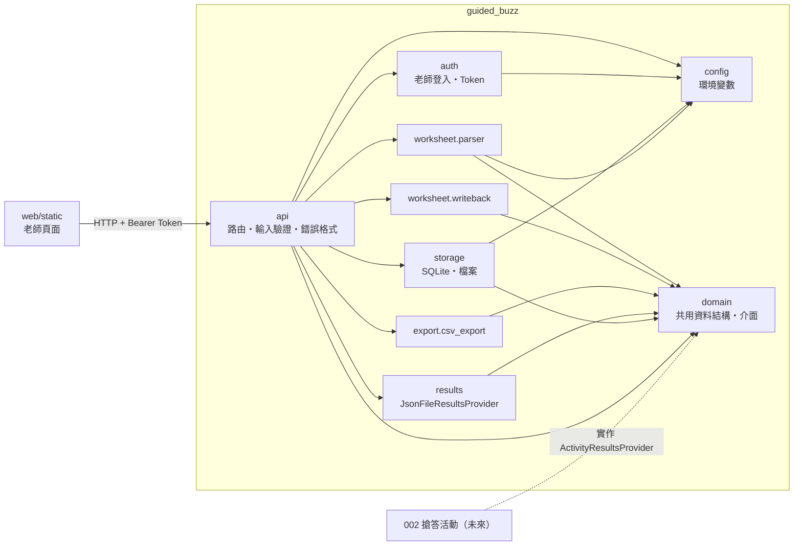

# Diagrams: 學習單匯入、答案寫回與結果匯出

**Feature**: [spec.md](./spec.md) | **Data model**: [data-model.md](./data-model.md) | **API**: [contracts/http-api.md](./contracts/http-api.md)

依 Constitution 原則 VII，以下圖表須在實作前審閱。設計變更時先改圖，再改程式。

## 1. 循序圖：匯入學習單並確認（US1）

## 2. 循序圖：答案寫回（US2）

## 3. 循序圖：匯出 CSV（US3）

## 4. 類別圖：共用資料結構（定義在 domain 模組）

## 5. 狀態圖：學習單匯入狀態

## 6. 模組相依圖

規則：`domain` 不依賴任何其他模組；`parser`、`writeback`、`export` 為不做 I/O 的純函式模組
（輸入 bytes 或物件，輸出結果），可以獨立做單元測試。
