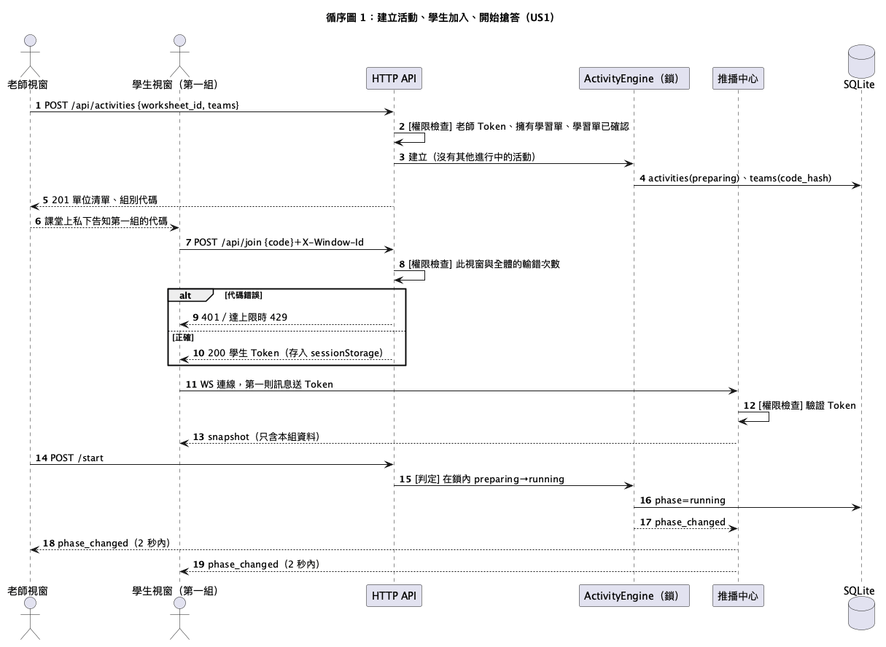
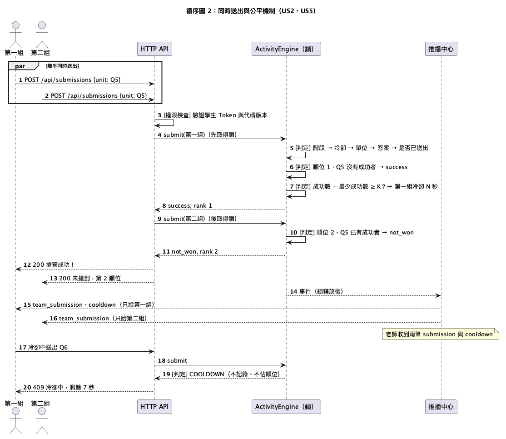
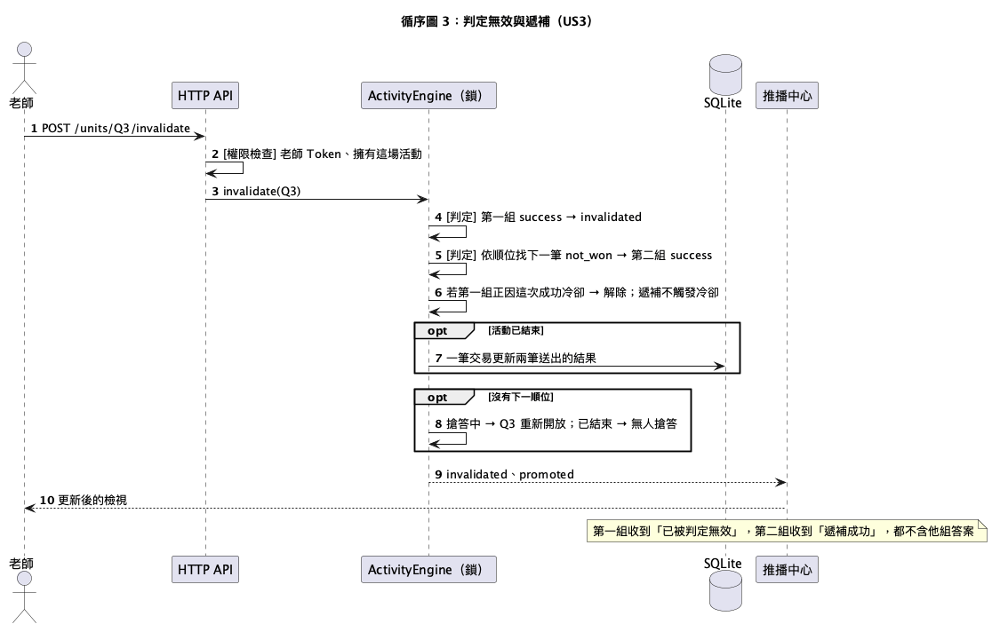
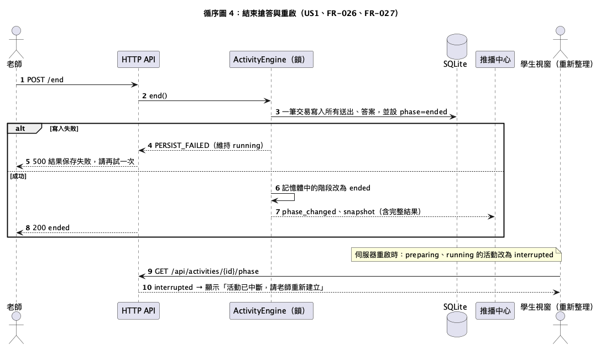
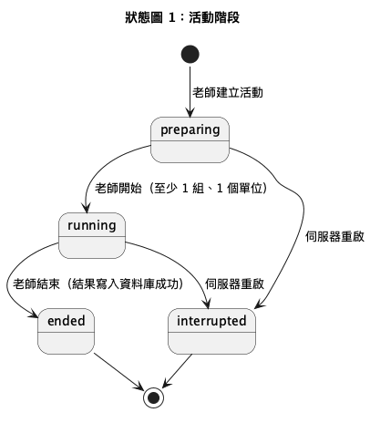
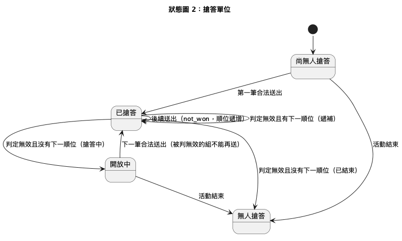
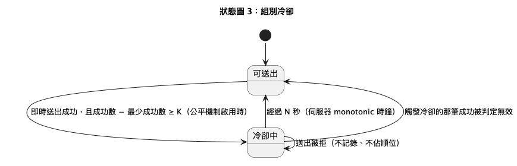
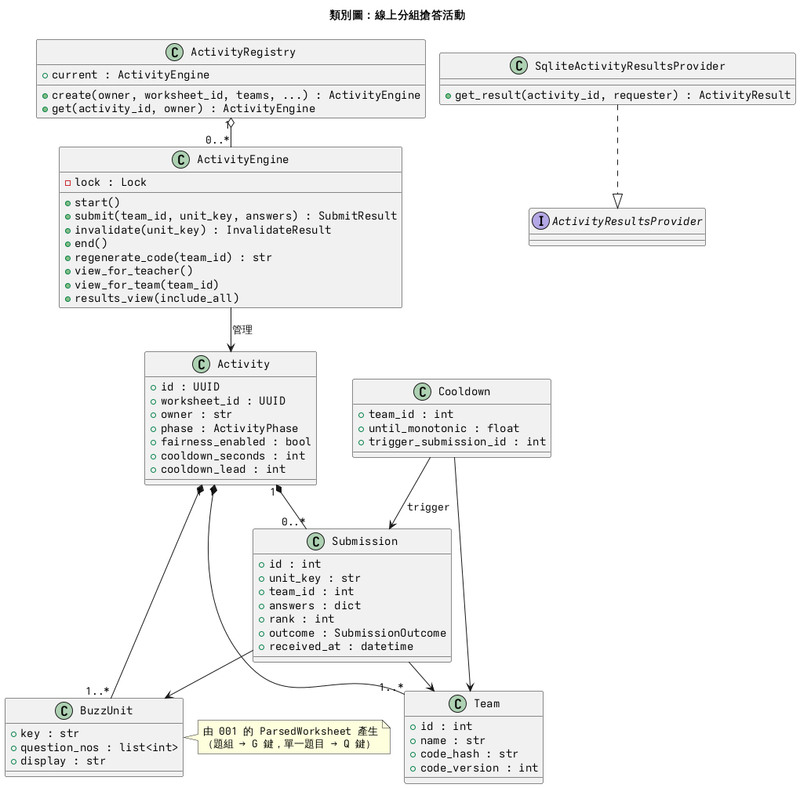
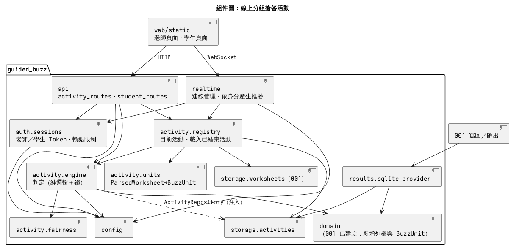

# Diagrams: 線上分組搶答活動

**審閱**：2026-11-23，9 張 .puml 已逐張對照 spec.md、data-model.md、contracts/，內容一致（tasks T001）。
本機未安裝 PlantUML，PNG 沿用 repo 中既有版本；之後修改 .puml 時須重新產生。

**Feature**: [spec.md](./spec.md) | **Data model**: [data-model.md](./data-model.md) | **API**: [contracts/](./contracts/)

依 Constitution 原則 VII，圖表以 PlantUML 撰寫，原始檔與 PNG 存放在
[`diagrams/002-online-buzz-activity/`](../../diagrams/002-online-buzz-activity/)，須在實作前審閱。
圖中「[權限檢查]」標示伺服器的權限檢查點，「[判定]」標示伺服器的判定點。

產生 PNG（在 repo 根目錄執行）：

```bash
plantuml -tpng "./diagrams/**/*.puml"
```

| # | 圖表 | 原始檔 | 對應需求 |
|---|------|--------|----------|
| 1 | 時序圖：建立活動、學生加入、開始搶答 | [01-sequence-start.puml](../../diagrams/002-online-buzz-activity/01-sequence-start.puml) | US1 |
| 2 | 時序圖：同時送出與公平機制 | [02-sequence-submit-fairness.puml](../../diagrams/002-online-buzz-activity/02-sequence-submit-fairness.puml) | US2、US5 |
| 3 | 時序圖：判定無效與遞補 | [03-sequence-invalidate.puml](../../diagrams/002-online-buzz-activity/03-sequence-invalidate.puml) | US3 |
| 4 | 時序圖：結束搶答與重啟 | [04-sequence-end-restart.puml](../../diagrams/002-online-buzz-activity/04-sequence-end-restart.puml) | US1、FR-026、FR-027 |
| 5 | 狀態圖：活動階段 | [05-state-activity-phase.puml](../../diagrams/002-online-buzz-activity/05-state-activity-phase.puml) | US1 |
| 6 | 狀態圖：搶答單位 | [06-state-buzz-unit.puml](../../diagrams/002-online-buzz-activity/06-state-buzz-unit.puml) | US2、US3 |
| 7 | 狀態圖：組別冷卻 | [07-state-team-cooldown.puml](../../diagrams/002-online-buzz-activity/07-state-team-cooldown.puml) | US5 |
| 8 | 類別圖 | [08-class.puml](../../diagrams/002-online-buzz-activity/08-class.puml) | 共用資料結構 |
| 9 | 組件圖：模組相依 | [09-component.puml](../../diagrams/002-online-buzz-activity/09-component.puml) | 架構 |

## 預覽











## 設計規則

- `activity.engine` 不直接處理 HTTP 或 WebSocket，只回傳結果與事件清單；推播由 `realtime` 在鎖釋放後送出。
- 時鐘以注入方式提供，方便測試冷卻。
