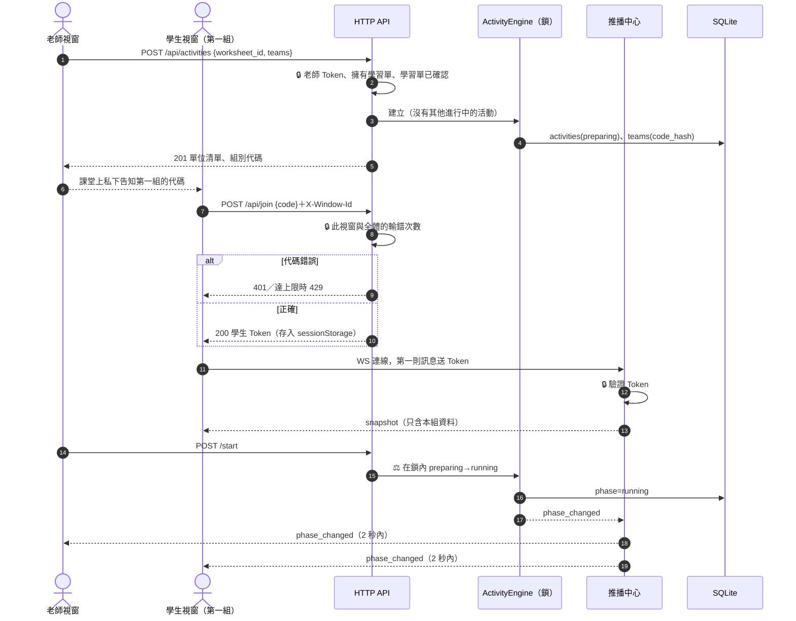
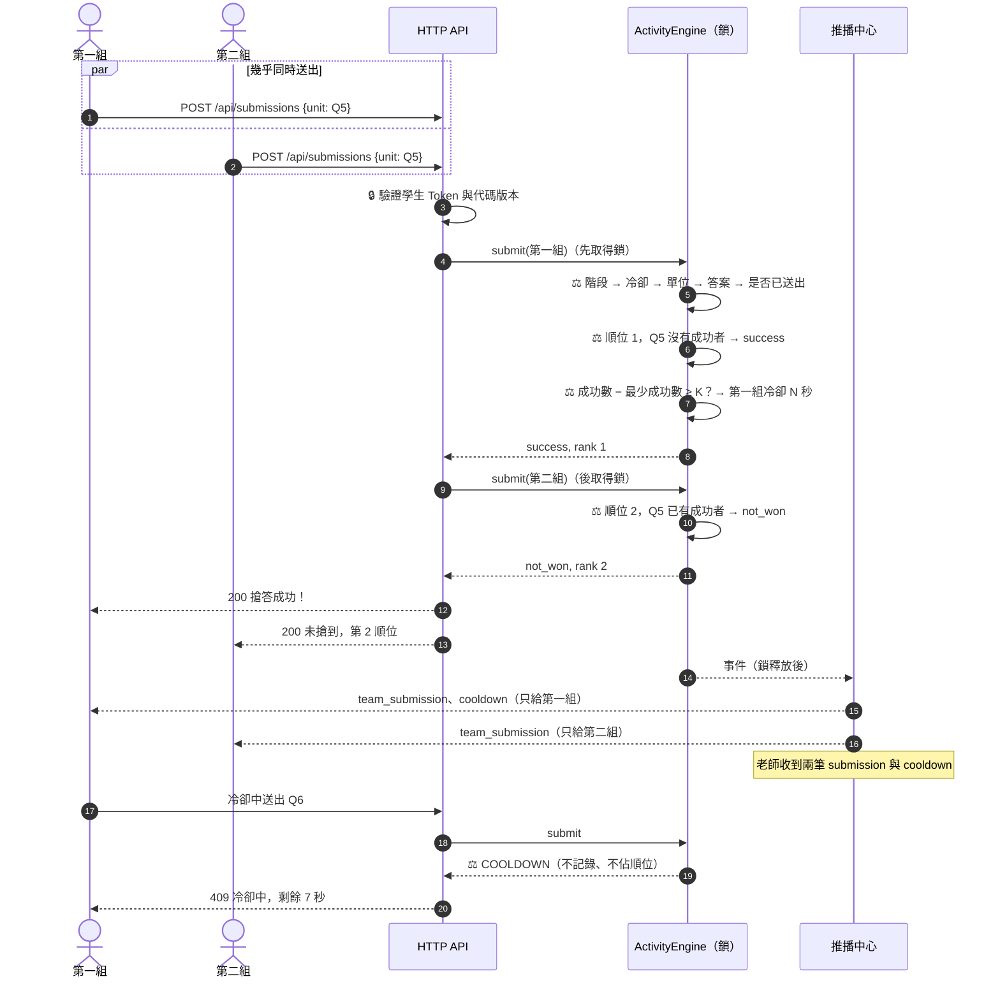
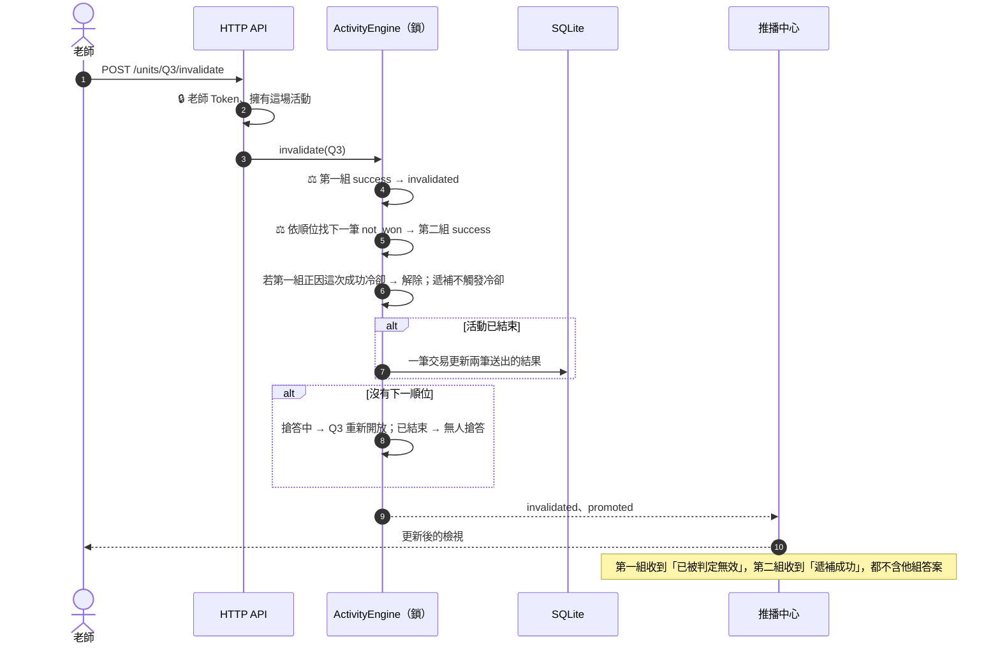
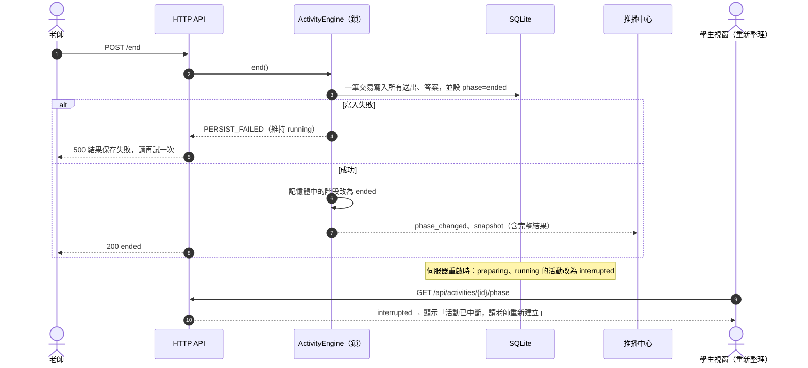
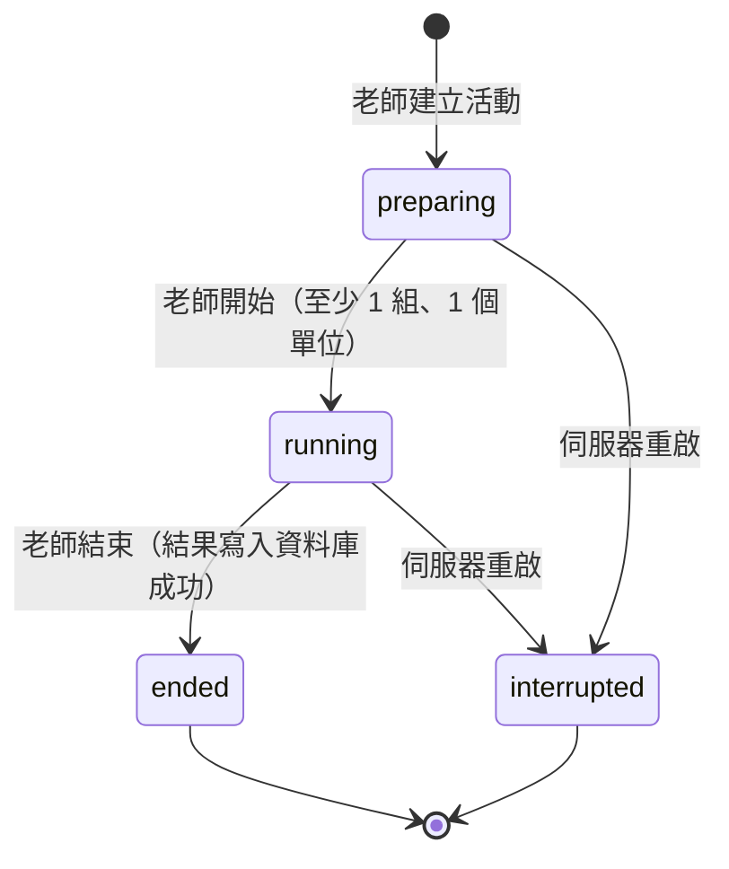
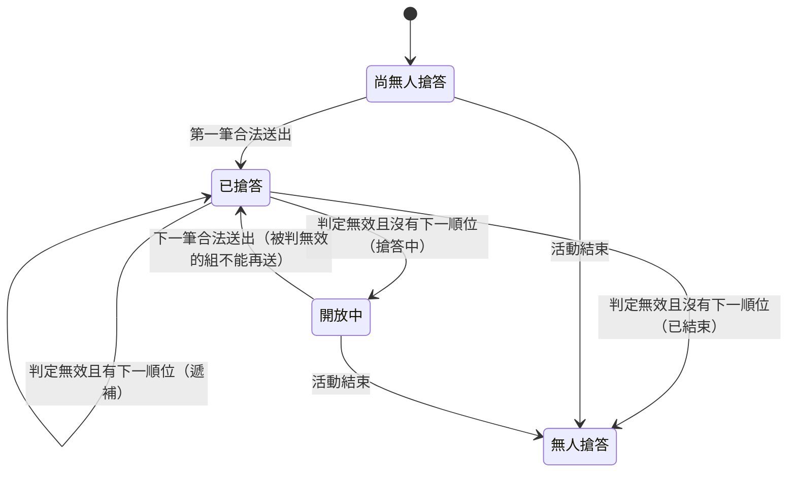
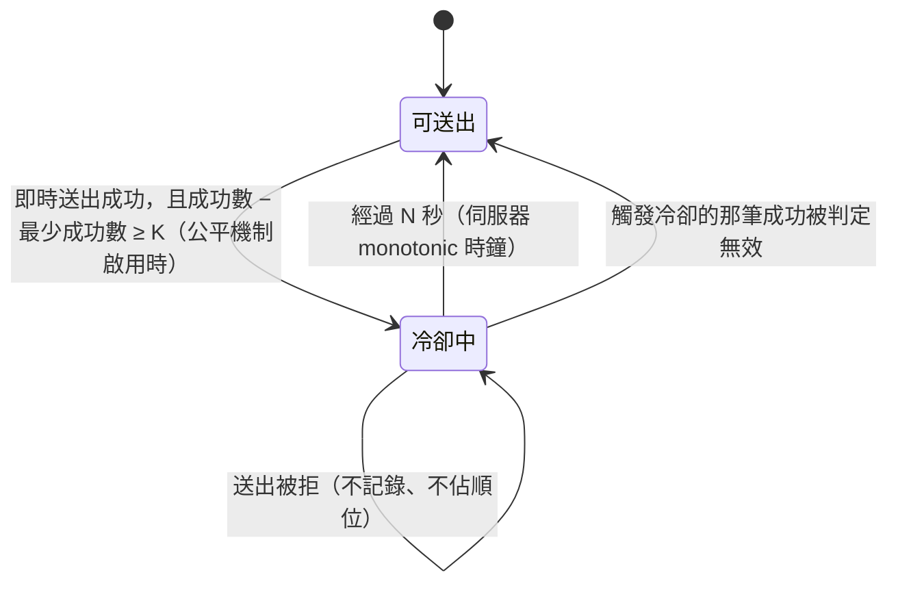
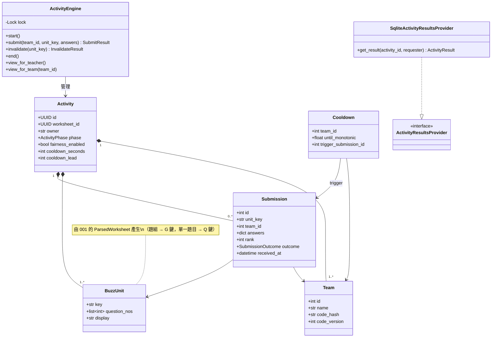
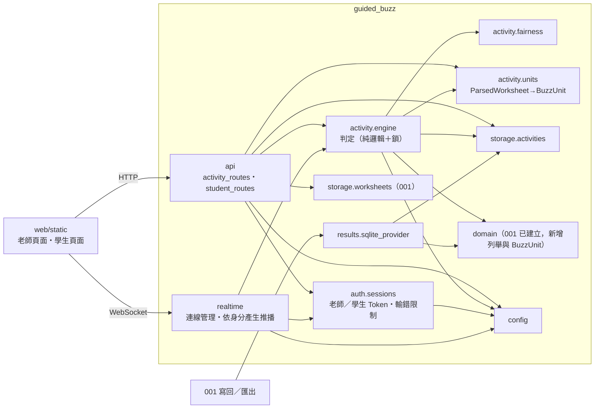

# Diagrams: 線上分組搶答活動

**Feature**: [spec.md](./spec.md) | **Data model**: [data-model.md](./data-model.md) | **API**: [contracts/](./contracts/)

依 Constitution 原則 VII，以下圖表須在實作前審閱。圖中「🔒」標示伺服器的權限檢查點，「⚖」標示伺服器的判定點。

## 1. 循序圖：建立活動、學生加入、開始搶答（US1）

## 2. 循序圖：同時送出與公平機制（US2、US5）

## 3. 循序圖：判定無效與遞補（US3）

## 4. 循序圖：結束搶答與重啟（US1、FR-026、FR-027）

## 5. 狀態圖：活動階段

## 6. 狀態圖：搶答單位

## 7. 狀態圖：組別冷卻

## 8. 類別圖

## 9. 模組相依圖

規則：`activity.engine` 不直接處理 HTTP 或 WebSocket，只回傳結果與事件清單；推播由 `realtime` 在鎖釋放後送出。
時鐘以注入方式提供，方便測試冷卻。
