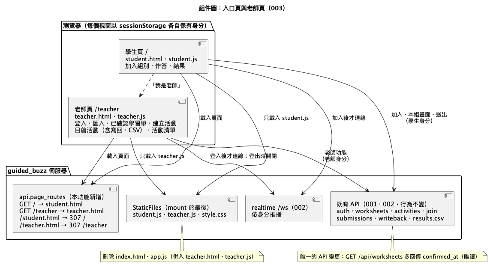
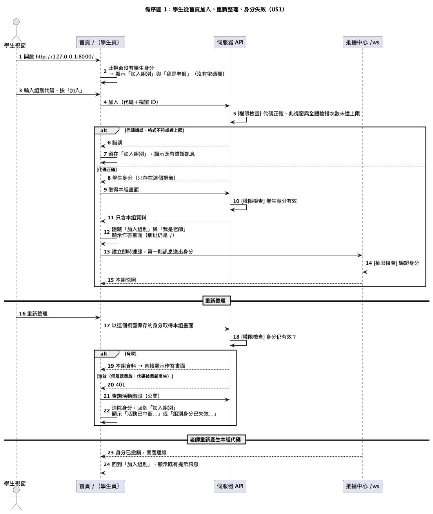
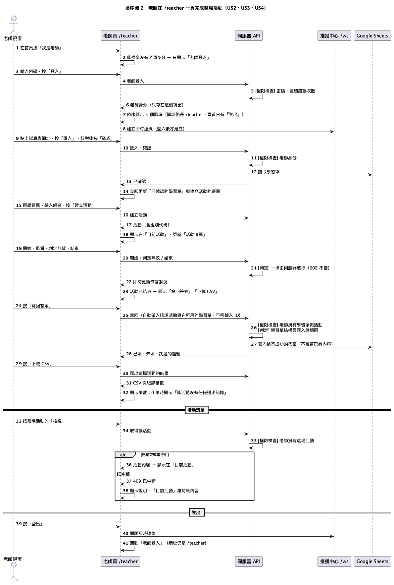
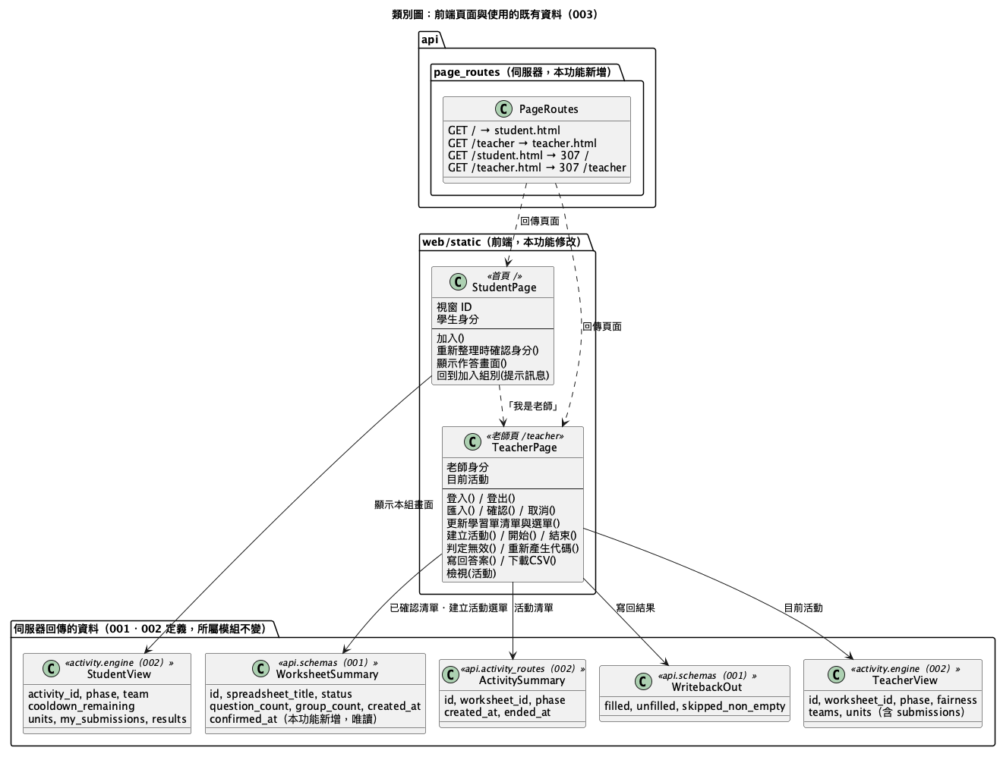
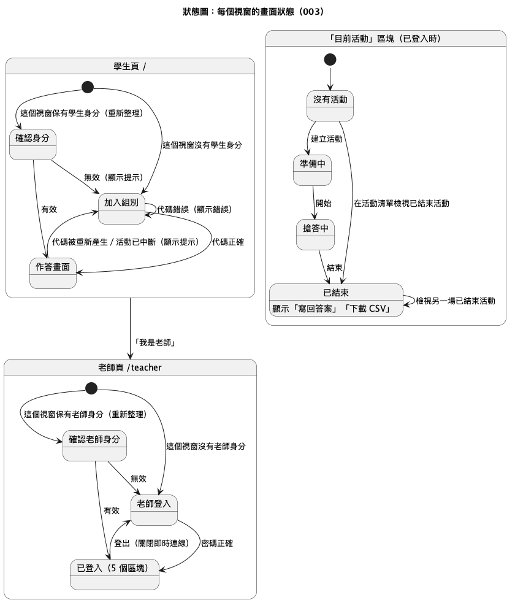

# Diagrams: 入口頁與老師頁面對齊 OpenSpec 組

**Feature**: [spec.md](./spec.md) | **來源**: [handoff-from-openspec.md](./handoff-from-openspec.md)

依 Constitution 原則 VII，圖表以 PlantUML 撰寫，原始檔與 PNG 存放在
[`diagrams/003-align-entry-pages/`](../../diagrams/003-align-entry-pages/)，須在實作前審閱。
圖中「[權限檢查]」標示伺服器的權限檢查點，「[判定]」標示伺服器的判定點；本功能不新增任何檢查點或判定點，標示出來是為了確認新頁面沒有繞過它們。

產生 PNG（在 repo 根目錄執行）：

```bash
plantuml -tpng "./diagrams/**/*.puml"
```

| # | 圖表 | 原始檔 | 對應需求 |
|---|------|--------|----------|
| 1 | 組件圖：頁面、頁面路由與既有 API | [01-component.puml](../../diagrams/003-align-entry-pages/01-component.puml) | FR-001、FR-007、FR-023、FR-025、FR-027 |
| 2 | 時序圖：學生從首頁加入、重新整理、身分失效 | [02-sequence-student-entry.puml](../../diagrams/003-align-entry-pages/02-sequence-student-entry.puml) | US1、E-01、E-02、E-09 |
| 3 | 時序圖：老師在 /teacher 一頁完成整場活動 | [03-sequence-teacher-page.puml](../../diagrams/003-align-entry-pages/03-sequence-teacher-page.puml) | US2、US3、US4、E-03～E-07 |
| 4 | 類別圖：前端頁面與使用的既有資料 | [04-class.puml](../../diagrams/003-align-entry-pages/04-class.puml) | FR-011、FR-018、FR-026 |
| 5 | 狀態圖：每個視窗的畫面狀態 | [05-state-window.puml](../../diagrams/003-align-entry-pages/05-state-window.puml) | FR-005、FR-006、FR-015、FR-021、FR-022、E-08 |

## 預覽







## 實作後驗證（T021，2026-11-27）

已對照最終程式碼檢查 5 張圖與 001、002 的組件圖。類別圖原本把舊網址導向畫成前端元件，實際是由後端 `api.page_routes` 以 307 導向，已更新 `.puml` 與 PNG；其餘圖表與程式一致。

## 設計規則

- 頁面只負責顯示與呼叫既有 API。誰能做什麼、誰先搶到，都由伺服器判定，與 001、002 相同。
- 學生頁與老師頁各自只載入自己需要的程式（FR-026）。
- 身分只存在各自的視窗裡；即時連線只在登入或加入之後才建立（FR-023、FR-024）。
